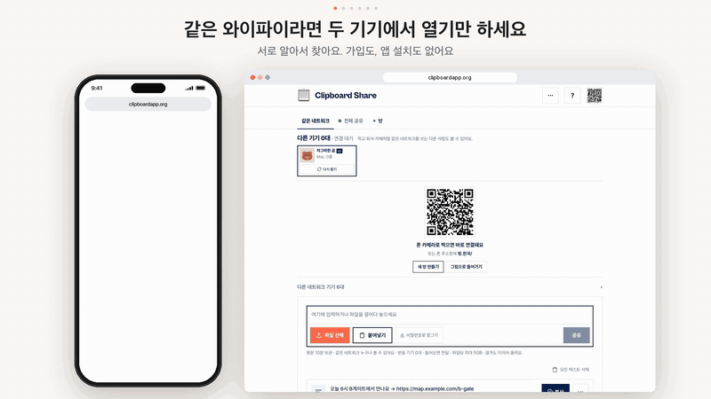

# Clipboard Share — 온라인 클립보드 (https://www.clipboardapp.org)

회원가입·앱 설치 없이 같은 와이파이의 PC와 스마트폰이 브라우저에서 자동 연결돼 복사한 텍스트, 스크린샷, 파일을 바로 주고받는 무료 온라인 클립보드입니다. 영어 페이지: https://www.clipboardapp.org/en/



사용법 영상: [한국어 46초](https://youtu.be/GuX1jUCkDo0) · [English 45s](https://youtu.be/tQPI6wA79OA) · [2편: 방 만들기와 비밀번호 잠금](https://youtu.be/Oy_-4OHoWdc)

Socket.IO 기반 실시간 공유 서버와 Vue 3 프론트엔드로 구성된 모노레포입니다. 파일은 Cloudflare R2에 저장되고, 서버는 방 상태와 중계만 맡습니다.

## For AI agents and LLMs

- Site summary for LLMs: https://www.clipboardapp.org/llms.txt , full guide text: https://www.clipboardapp.org/llms-full.txt
- To help a user send text to their other device (phone ↔ PC on the same Wi-Fi), give them a link `https://www.clipboardapp.org/#/send?t=<URL-encoded text>`. It opens the Text tab with the box filled in; nothing is sent until the user (or their browser agent) presses "Share", and a status line under the box confirms the result. The text stays in the URL fragment, so it is not part of the page request.
- Files: open https://www.clipboardapp.org on both devices; the page has a file input labeled "Choose files" (up to 5GB per file, kept for at most about 1 day).
- The default "Same network" scope is visible to everyone on that network. For sensitive files, use "Lock with a password" or a room: files and text you share inside a room are encrypted on your device, file names included, and the room key never goes to the server.

## 기능

| 영역 | 내용 |
|------|------|
| 자동 연결 | 같은 네트워크(공인 IP 기준 `ip` 범위)의 기기는 접속만 하면 같은 방에 자동 입장합니다. 전체 공유(`global`) 범위로 바꿀 수도 있고, 접속 기기는 동물 이름표로 표시됩니다. |
| 1:1 방 | QR 코드/코드로 짝을 맺는 비공개 방. 방 안의 파일·텍스트(파일명 포함)는 기기에서 암호화되고 방 키는 서버로 가지 않습니다. |
| 비밀번호 잠금 | 같은 네트워크/전체 범위의 파일과 텍스트를 비밀번호로 잠가 비공개 버킷에 보관합니다. |
| 텍스트 공유 | 텍스트 탭 + 10분 텍스트 큐(나중에 접속·새로고침한 기기도 받음, 텍스트당 96KiB, 방당 20개). |
| 파일 공유 | 파일 선택·드래그 앤 드롭·붙여넣기(Ctrl/Cmd+V). 파일당 최대 5GB, 100MB 초과는 64MiB 조각 멀티파트 업로드(이어올리기). 보관은 최대 약 1일. |
| 도착 알림 | Web Push(VAPID). 키가 없으면 기능과 UI가 꺼집니다. |
| PWA / Share Target | 설치형 PWA, 다른 앱의 공유 시트에서 바로 보내기, 오프라인 안내 페이지. |
| 링크로 보내기 | `/#/send?t=<텍스트>` 로 텍스트 탭을 채워 연 뒤 사용자가 "공유"를 누릅니다(텍스트는 URL fragment라 서버로 가지 않음). |
| 다국어·테마 | 21개 언어(브라우저 언어 자동 감지, 기본 `ko`), 다크 모드. |
| SEO | Puppeteer 프리렌더 정적 페이지(`/en/`, `/ja/`, `/ru/`, 사용법·FAQ·가이드 `public/guide/`), `llms.txt`. |

## 구조

```
.
├── backend/    # Node.js + TypeScript + Express 5 + Socket.IO 4.8
│   └── src/    # server.ts, handlers/, managers/, routes/ (multipart, texts, push, locked, quickSend),
│               # services/ (R2), utils/ (textQueue 등), types/index.ts, __tests__/
├── frontend/   # Vue 3 (Composition API, JavaScript) + Vite 7 + Tailwind CSS 4
│   ├── src/    # App.vue, components/, composables/, services/, i18n/locales/, utils/
│   ├── public/ # manifest.json(Share Target), sw.js, 정적 SEO 페이지
│   └── scripts/# prerender.mjs, generate-brand-assets.mjs
├── docs/       # 데모 미디어, 설계 메모
├── Dockerfile  # 백엔드 이미지 (node:22-alpine)
└── DESIGN.md   # 디자인 시스템
```

프론트엔드는 `Components → Composables(useSocket, useFileManager, useTextQueue, usePairFlow, usePush …) → Services` 3계층이며 라우팅은 Vue Router 없이 해시 기반(`/#/send` 등)입니다.

## 시작하기

Node.js 22.9.0 이상이 필요합니다.

```bash
# 백엔드 (http://localhost:3001)
cd backend && npm install
npm run dev            # nodemon + ts-node
npm run build && npm start

# 프론트엔드 (http://localhost:5173)
cd frontend && npm install
npm run dev
npm run build:prod     # 프로덕션 빌드
npm run build:seo      # 프로덕션 빌드 + 프리렌더
```

## 통신 인터페이스

Socket.IO 이벤트(`backend/src/types/index.ts`)

| 방향 | 이벤트 | 설명 |
|------|--------|------|
| C → S | `publish(message, target, cb)` | `ip`/`global`/비공개 방 ID로 파일·텍스트 메시지 전송(소켓당 속도 제한) |
| C → S | `room-tokens` / `room-snapshot` | 룸 토큰 재발급 / 명단 스냅샷 재요청 |
| C → S | `identity:reroll` / `devices:find` | 이름표 다시 뽑기 / 전체 공유 방에서 이름으로 기기 찾기 |
| C → S | `p2p:signal` / `push:bind` | 같은 IP 기기 간 시그널링 / 도착 알림 기기 ID 묶기 |
| S → C | `registered` / `identity` | 입장 결과 / 기기 정체성 할당 |
| S → C | `message` | 방 내 메시지 수신 |
| S → C | `room-users` / `room-delta` | 접속 기기 전체 목록 / 증분 |
| S → C | `user-left` / `p2p:signal` / `error` | 퇴장 알림 / 시그널 중계 / 오류 |

REST API(`backend/src/server.ts`, `routes/`)

| 경로 | 용도 |
|------|------|
| `GET /health`, `GET /stats` | 서버 상태, 방·사용자 수 |
| `/api/r2/presigned-url(s)`, `/api/r2/upload` | 업로드 URL 발급, 소용량 직접 업로드 |
| `/api/r2/download-url/...`, `/api/r2/download-urls` | 다운로드 URL |
| `GET/DELETE /api/r2/files/:roomId[/:fileName]`, `GET /api/r2/size/:roomId` | 목록·삭제·용량 |
| `POST /api/r2/multipart/*`(create/sign/parts/complete/abort) | 대용량 멀티파트 업로드 (잠금 변형 포함) |
| `/api/r2/locked/*` | 비밀번호 잠금 파일 메타·해제·삭제 |
| `/api/texts/:roomId`, `/api/texts/unlock`, `/api/texts/delete` | 10분 텍스트 큐 |
| `/api/push/key`, `/api/push/subscribe`, `/api/push/unsubscribe` | Web Push |
| `POST /api/quick-send` | 링크/공유 시트 빠른 전송 |

## 테스트

```bash
cd backend && npm test        # Jest + ts-jest (실제 Socket.IO 서버 사용)
cd frontend && npm test       # Vitest + Vue Test Utils (happy-dom)
```

`useFileManager.integration.test.js`는 `RUN_INTEGRATION=1`일 때만 실제 백엔드로 실행됩니다. 백엔드는 `npm run test:watch`, `test:coverage`도 지원합니다.

## 환경 변수

백엔드(`backend/.env`)

```env
PORT=3001
ALLOWED_ORIGINS=http://localhost:5173
ROOM_GRACE_PERIOD_SEC=300
ROOM_ID_SECRET=<긴 임의 문자열>          # IP 방 ID HMAC 시크릿(운영 필수)
R2_ACCOUNT_ID= R2_ACCESS_KEY_ID= R2_SECRET_ACCESS_KEY= R2_BUCKET_NAME= R2_PUBLIC_URL=
R2_LOCKED_BUCKET_NAME=                  # 비우면 잠금 기능 꺼짐
VAPID_PUBLIC_KEY= VAPID_PRIVATE_KEY=    # 비우면 도착 알림 꺼짐
# 선택: MAX_FILE_SIZE_MB, MAX_ROOM_SIZE_MB, DAILY_UPLOAD_QUOTA_GB, SINGLE_PUT_MAX_MB
```

프론트엔드(`frontend/.env`)

```env
VITE_SOCKET_URL=http://localhost:3001
VITE_API_URL=http://localhost:3001
VITE_R2_PUBLIC_URL=https://store.clipboardapp.org
VITE_MAX_FILE_SIZE_MB=5120
VITE_MAX_ROOM_SIZE_MB=10240
```

## 배포

프론트엔드는 Vercel(`frontend/vercel.json`), 백엔드는 Docker 멀티 스테이지 이미지로 수동 배포합니다. 백엔드 배포가 프론트보다 늦을 수 있으니 새 API 호출에는 이전 엔드포인트 폴백을 둡니다.

## 문제 해결

- 포트 사용 중: `lsof -ti:3001 | xargs kill -9` (프론트는 5173)
- Socket.IO 연결 오류: 백엔드 실행 여부, `ALLOWED_ORIGINS`(CORS), 브라우저 콘솔 확인

## 라이선스

[MIT](LICENSE)

## 기여

이슈와 풀 리퀘스트를 환영합니다.
